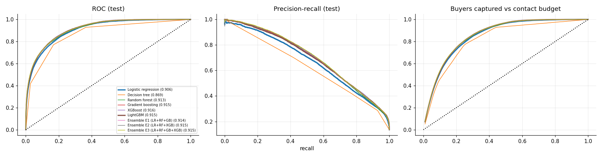
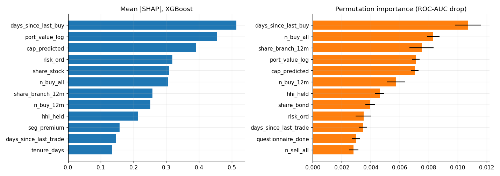
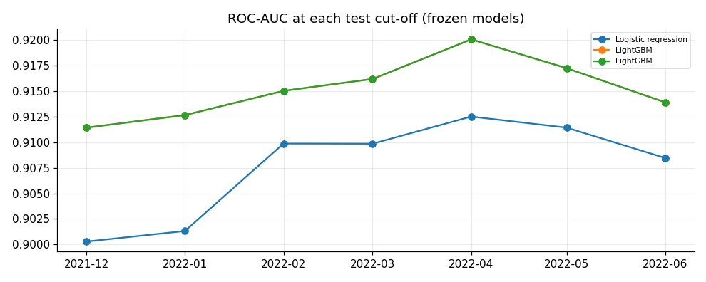

# Investor Propensity & Targeting Model

[](https://github.com/bravo2024/investor/actions/workflows/ci.yml) [](https://investort.streamlit.app) [](https://github.com/bravo2024/investor/blob/main/LICENSE)

Who will buy in the next six months, and whom should the bank contact? A Streamlit dashboard and a
reproducible notebook: rank the investor base by the chance of a BUY in the next six months, then
decide how many customers to contact. Model card:
[`MODEL_CARD.md`](https://github.com/bravo2024/investor/blob/main/MODEL_CARD.md).

**Live app:** <https://investort.streamlit.app> (no login, six pages, frozen artifacts).

## Summary

A wealth and retail bank can contact only part of its investor base. This project ranks **existing investment customers** of a large European financial institution by the chance of placing **at least one BUY order in the next six months**, using only what is known before a cut-off date. Data: FAR-Trans (University of Glasgow, CC BY 4.0), 29,090 customers, 806 assets, 388,048 transactions (228,913 buys), 2018-01 to 2022-11.
All models are classical: logistic regression, decision tree, random forest, scikit-learn gradient boosting, XGBoost, LightGBM and three soft-voting ensembles (E1 = LR + RF + GB, E2 = LR + RF + XGB, E3 = LR + RF + GB + XGB).

Validation is strictly **out of time**: monthly cut-offs, training on 2019-10 to 2020-10, validation on 2021-04 to 2021-06, test on 2021-12 to 2022-06 with a six-month purge gap between blocks. Test: 197,513 customer-cut-off rows from 28,568 customers, **13.6% of them buy** within six months.

| Model | ROC-AUC (95% CI) | PR-AUC | KS | Buyers reached @10% | @20% | @30% |
|---|---|---|---|---|---|---|
| Logistic regression | 0.906 [0.903, 0.910] | 0.671 | 0.635 | 51.3% | 72.7% | 84.8% |
| Decision tree | 0.869 [0.864, 0.874] | 0.496 | 0.603 | 45.8% | 67.1% | 81.4% |
| Random forest | 0.913 [0.909, 0.916] | 0.699 | 0.643 | 53.4% | 74.2% | 85.2% |
| Gradient boosting | 0.915 [0.911, 0.918] | 0.699 | 0.651 | 52.7% | 74.1% | 85.9% |
| XGBoost | 0.916 [0.912, 0.919] | 0.700 | 0.658 | 52.9% | 74.2% | 86.3% |
| LightGBM | 0.915 [0.911, 0.918] | 0.696 | 0.651 | 52.4% | 74.3% | 86.0% |
| Ensemble E1 (LR+RF+GB) | 0.914 [0.911, 0.918] | 0.702 | 0.648 | 53.3% | 74.3% | 85.7% |
| Ensemble E2 (LR+RF+XGB) | 0.915 [0.911, 0.918] | 0.702 | 0.650 | 53.3% | 74.2% | 85.7% |
| Ensemble E3 (LR+RF+GB+XGB) | 0.915 [0.912, 0.919] | 0.704 | 0.653 | 53.4% | 74.3% | 86.1% |

Buyers reached @k% = share of the cut-off's eventual buyers among the top k% of customers by score (ranked within each cut-off, pooled over seven test cut-offs). Intervals: paired bootstrap, 1,000 resamples of customers.

**Models against logistic regression** (paired bootstrap, same resamples):

| Model minus logistic regression | ROC-AUC difference [95% CI] | PR-AUC difference [95% CI] | Capture@20% difference [95% CI] |
|---|---|---|---|
| Decision tree | -0.037 [-0.041, -0.035] | -0.176 [-0.183, -0.169] | -0.056 [-0.064, -0.048] |
| Random forest | +0.006 [+0.005, +0.007] | +0.028 [+0.023, +0.032] | +0.015 [+0.009, +0.021] |
| Gradient boosting | +0.008 [+0.007, +0.010] | +0.028 [+0.023, +0.032] | +0.014 [+0.008, +0.020] |
| XGBoost | +0.009 [+0.008, +0.011] | +0.028 [+0.024, +0.032] | +0.015 [+0.009, +0.021] |
| LightGBM | +0.008 [+0.007, +0.010] | +0.025 [+0.020, +0.029] | +0.016 [+0.010, +0.023] |
| Ensemble E1 (LR+RF+GB) | +0.008 [+0.007, +0.009] | +0.031 [+0.027, +0.034] | +0.016 [+0.012, +0.020] |
| Ensemble E2 (LR+RF+XGB) | +0.008 [+0.007, +0.009] | +0.031 [+0.027, +0.034] | +0.015 [+0.011, +0.020] |
| Ensemble E3 (LR+RF+GB+XGB) | +0.009 [+0.008, +0.010] | +0.032 [+0.029, +0.036] | +0.016 [+0.012, +0.021] |

**Ensembles against the best single model on validation (LightGBM)**:

| Ensemble minus LightGBM | ROC-AUC difference [95% CI] | PR-AUC difference [95% CI] | Capture@20% difference [95% CI] |
|---|---|---|---|
| Ensemble E1 (LR+RF+GB) | -0.000 [-0.001, +0.000] | +0.006 [+0.004, +0.009] | -0.001 [-0.005, +0.004] |
| Ensemble E2 (LR+RF+XGB) | -0.000 [-0.001, +0.001] | +0.006 [+0.004, +0.009] | -0.001 [-0.006, +0.003] |
| Ensemble E3 (LR+RF+GB+XGB) | +0.001 [-0.000, +0.001] | +0.008 [+0.005, +0.010] | +0.000 [-0.004, +0.004] |

**Threshold metrics and top-decile lift** (threshold = the raw probability that maximises F1 on validation, applied unchanged to test):

| Model | threshold | precision | recall | F1 | top-decile precision | top-decile lift |
|---|---|---|---|---|---|---|
| Logistic regression | 0.456 | 36.1% | 87.0% | 0.511 | 69.6% | 5.13 |
| Decision tree | 0.274 | 28.6% | 92.9% | 0.437 | 62.1% | 4.58 |
| Random forest | 0.174 | 35.7% | 88.2% | 0.508 | 72.4% | 5.33 |
| Gradient boosting | 0.242 | 41.9% | 83.1% | 0.557 | 71.6% | 5.27 |
| XGBoost | 0.254 | 44.2% | 81.5% | 0.573 | 71.7% | 5.29 |
| LightGBM | 0.253 | 42.0% | 83.0% | 0.558 | 71.0% | 5.24 |
| Ensemble E1 (LR+RF+GB) | 0.317 | 39.3% | 85.4% | 0.538 | 72.3% | 5.33 |
| Ensemble E2 (LR+RF+XGB) | 0.303 | 38.6% | 86.1% | 0.533 | 72.3% | 5.33 |
| Ensemble E3 (LR+RF+GB+XGB) | 0.292 | 39.7% | 85.5% | 0.542 | 72.4% | 5.34 |

**Business result.** Contacting the top 20% of customers reaches **74.3% of eventual buyers** with LightGBM (best model on validation; precision 50.4% against a 13.6% base rate, lift 3.72). Logistic regression reaches 72.7%, and the best ensemble on validation (Ensemble E3 (LR+RF+GB+XGB)) 74.3%. The top 10% already holds 52.4% of buyers at 71.0% precision (lift 5.24).
The ordering is dominated by recent activity, so the gap between a transparent logistic regression and the tree models is small in ROC-AUC (about +0.009 for XGBoost, interval excludes zero) and the ensembles are statistically tied with the best single model in ROC-AUC and capture; their only reliable edge is PR-AUC (see the table above).
Among customers who traded in the last 12 months (56.4% of rows, uptake 21.9%) the headline model's ROC-AUC is 0.891; among customers with no trade in 12 months (uptake 2.8%) it is 0.855.

| Test ROC and PR curves | Drivers (SHAP) | Rolling-origin stability |
|---|---|---|
|  |  |  |

Kaggle run: `vivekkopthsd/far-trans-wealth-uptake` (private, CPU), see kernel page, runtime 4,772s. Numbers in this file are generated from `artifacts/` by `build_readme.py`.

## Streamlit app

**Investor Propensity & Targeting Model** runs as six pages, all fed by the frozen files in
`artifacts/`: the app never downloads data and never trains, so it starts in seconds and deploys as-is.

| Page | What it shows |
|---|---|
| Overview | out-of-time design, split sizes, class balance, test metrics with bootstrap intervals |
| Models & ensembles | ROC and precision-recall curves, paired-bootstrap differences, tuning gains, VIF, calibration, rolling-origin stability |
| Segments | uptake and capture by segment, risk profile, capacity and activity, propensity bands, K-Means clusters, product categories |
| Contact budget | buyers reached, precision and lift for any contact budget between 1% and 60% |
| Drivers | SHAP and permutation importance, per-feature SHAP scatter, logistic-regression coefficients, feature dictionary |
| Customer lookup | recomputes one customer's calibrated score from the frozen models, with band and TreeSHAP contributions |

**Run it locally**

```bash
pip install -r requirements.txt
streamlit run app.py
```

**Deploy on Streamlit Community Cloud**

1. Push this folder as its own repository (see `git` steps in the quick start below).
2. Open <https://share.streamlit.io> -> **Create app** -> **Deploy a public app from GitHub**.
3. Repository `bravo2024/investor`, branch `main`, main file path `app.py`.
4. **Advanced settings** -> Python **3.13** (3.11 and 3.12 also work). Do not pick 3.14:
   `scikit-learn==1.6.1` and `numpy==2.1.3` publish no wheels for it.
   Community Cloud ignores `runtime.txt`, so the version has to be set in that dialog.
5. Deploy. No secrets and no data download: the app reads the committed `artifacts/`
   (about 14 MB, frozen models included).

No system packages are needed, so there is no `packages.txt`. The app installs
`xgboost-cpu` rather than `xgboost`: the PyPI `xgboost` wheel drags in
`nvidia-nccl-cu12` on Linux (about 300 MB of CUDA libraries), while this
project only scores single customer rows on CPU. Same import name, same model,
no GPU dependency.

## How to run

```bash
# app only (this is what Streamlit Community Cloud installs)
pip install -r requirements.txt
streamlit run app.py

# everything: app plus notebook, README generator and tests
pip install -r requirements-dev.txt
jupyter nbconvert --to notebook --execute FARTransWealth.ipynb --output FARTransWealth.executed.ipynb   # downloads FAR-Trans into ./data, writes ./artifacts
python build_readme.py       # regenerates this file from artifacts/
pytest -q                    # 22 checks: artifacts, frozen models, notebook, README numbers, app pages
```

Push to GitHub from this folder:

```bash
git init -b main && git add . && git commit -m "Investor propensity model: notebook, artifacts, Streamlit app"
git remote add origin https://github.com/bravo2024/investor.git && git push -u origin main
```

The frozen `artifacts/` are committed, so `streamlit run app.py` and `pytest` work without re-running the notebook. Environment variables: `FAR_DATA` (folder holding `FAR-Trans.zip`), `FAR_ART` (output folder), `FAR_SMOKE=1` (small sample run).
Kaggle: `kaggle kernels push -p .` pushes `run_far_trans.py`, a script kernel that embeds the notebook, executes it with nbclient and leaves `FARTransWealth.executed.ipynb` and `artifacts/` as output.

## Project structure

```
FARTransWealth.ipynb            all analysis code, top to bottom (no local package)
FARTransWealth.executed.ipynb   the same notebook executed on Kaggle, every output stored
app.py                          Streamlit app (reads artifacts/ only)
build_readme.py                 README generator
artifacts/                      metrics, tables, figures, scored test rows, frozen models (models/)
tests/                          artifact, frozen-model, notebook, README and app tests
run_far_trans.py, kernel-metadata.json   Kaggle runner
requirements.txt                app runtime (exactly what Community Cloud installs)
requirements-dev.txt            notebook, README generation and tests
.github/workflows/ci.yml        pytest plus a six-page Streamlit smoke test on every push
.streamlit/config.toml          theme
MODEL_CARD.md                   intended use, evaluation, limitations
LICENSE                         MIT for the code; the data is CC BY 4.0
```

## Tests and CI

`pytest -q` runs 22 checks: every artifact file is present; the provenance hashes, row counts and
the 7,141 / 7,318 simulated-attribute counts match the source; the split respects the six-month
purge gap; capture is monotone in the contact budget; the frozen joblib and JSON models reproduce
the stored scores and the test metrics; the notebook imports only standard, scikit-learn, xgboost,
lightgbm and shap modules and stores no error output; the numbers in this file match `artifacts/`;
and every Streamlit page renders under `streamlit.testing.v1.AppTest`.
`.github/workflows/ci.yml` runs the suite on Python 3.13, then installs `requirements.txt` alone and
renders all six pages, which is the same environment Community Cloud builds.

## Data gate

Downloaded from `https://researchdata.gla.ac.uk/id/eprint/1658` (zip 9.8 MB, sha256 `d0d6cfe027732bab...`, licence CC BY 4.0); full hashes, row and column counts per file are in `artifacts/data_provenance.json`.
Counts reproduced: 29,090 customers, 806 assets, 703,303 price points, 228,913 buys, 159,135 sells (388,048 transactions; the paper's headline figures are one row higher, not material). Transactions 2018-01-02 to 2022-11-30, prices to 2022-11-29.

**Simulated or estimated fields** (dataset README: "Predicted_Conservative / Predicted_Income / Predicted_Balanced / Predicted_Aggressive: Same as earlier, but predicted by an algorithm."; paper: "In case they have not, the score is simulated through an automated process"):
7,141 customers have a predicted (simulated) risk profile and 7,318 an estimated investment capacity, matching the paper's 7,141 and 7,318. Both are kept as flagged features. Segment, risk and capacity never change between a customer's records, so one final value per customer is used at every cut-off; an ablation (below) shows the effect of removing all customer attributes.
The gate passed: dated Buy/Sell transactions with customer ids over 59 months and customer attributes support a customer-level, time-split propensity task.

## Methods notes

**Task.** At each monthly cut-off T, every customer with a record before T (including the opening book) is one row; label = at least one BUY in [T, T + 6 months). Variants: BUY of a stock, a fund (MTF) or a bond.
**Opening positions.** About 9% of all rows are dated 2018-01-02, the first day of data. They are the bank's opening book and count as holdings, but not as trading events in recency, frequency or labels.
**Features.** 47 plain-English features built only from rows before T (37 after the Spearman screen, 33 for logistic regression after VIF pruning), documented in `artifacts/feature_dictionary.csv`: recency, frequency and value of buys and sells, net-flow trend (last 3 vs prior 3 months), holdings (count, categories, market value from close prices, concentration, holding period), channel mix, 1-month and 3-month return of held assets, tenure, segment, risk profile, capacity band, questionnaire.

**Split and purge gap.**

| split | cut-offs | first - last cut-off | rows | customers | buyers | positive rate |
|---|---|---|---|---|---|---|
| train | 13 | 2019-10 to 2020-10 | 278,610 | 22,708 | 46,676 | 16.8% |
| valid | 3 | 2021-04 to 2021-06 | 74,959 | 25,126 | 14,294 | 19.1% |
| test | 7 | 2021-12 to 2022-06 | 197,513 | 28,568 | 26,803 | 13.6% |

Test uptake is lower than training uptake: a real drift that is left in. The first snapshot is 2019-10 because trading data are thin before mid 2019 (uptake about 5% against 16% after).

**Class balance.** Training positive rate 16.8%. None vs class_weight vs SMOTE (SMOTE inside the training sample only), two default models, validation scores:

| strategy | model | val ROC-AUC | val PR-AUC | val capture@20% | val Brier | mean predicted |
|---|---|---|---|---|---|---|
| none | Logistic regression | 0.888 | 0.678 | 0.599 | 0.105 | 0.194 |
| none | LightGBM | 0.908 | 0.719 | 0.649 | 0.094 | 0.210 |
| class_weight | Logistic regression | 0.889 | 0.675 | 0.597 | 0.141 | 0.340 |
| class_weight | LightGBM | 0.907 | 0.718 | 0.653 | 0.131 | 0.339 |
| smote | Logistic regression | 0.887 | 0.669 | 0.595 | 0.142 | 0.337 |
| smote | LightGBM | 0.893 | 0.695 | 0.624 | 0.102 | 0.228 |

Rule fixed in advance: switch only if another strategy beats "none" by 0.005 validation PR-AUC. Chosen: **none**. Re-weighting and SMOTE lift the mean predicted probability far above the true rate (Brier gets worse) without improving ranking, and the contact-budget and calibration work needs honest probabilities. Logistic regression still searched `class_weight` as a hyper-parameter.

**Tuning on validation only** (small random searches; the untuned configuration is always a candidate; tables in `artifacts/tuning_*.csv`, parameters in `best_params.json`):

| model | val ROC-AUC untuned | val ROC-AUC tuned | test ROC-AUC untuned | test ROC-AUC tuned | test PR-AUC untuned | test PR-AUC tuned |
|---|---|---|---|---|---|---|
| Logistic regression | 0.888 | 0.890 | 0.907 | 0.906 | 0.674 | 0.671 |
| Decision tree | 0.851 | 0.863 | 0.880 | 0.869 | 0.585 | 0.496 |
| Random forest | 0.897 | 0.897 | 0.913 | 0.913 | 0.701 | 0.699 |
| Gradient boosting | 0.897 | 0.910 | 0.913 | 0.915 | 0.695 | 0.699 |
| XGBoost | 0.906 | 0.909 | 0.915 | 0.916 | 0.700 | 0.700 |
| LightGBM | 0.909 | 0.910 | 0.914 | 0.915 | 0.696 | 0.696 |
| Ensemble E1 (LR+RF+GB) | 0.897 | 0.902 | 0.914 | 0.914 | 0.697 | 0.702 |
| Ensemble E2 (LR+RF+XGB) | 0.901 | 0.902 | 0.915 | 0.915 | 0.700 | 0.702 |
| Ensemble E3 (LR+RF+GB+XGB) | 0.900 | 0.904 | 0.915 | 0.915 | 0.700 | 0.704 |

Tuning gains on the test period are small (largest test ROC-AUC gain +0.002); the shallow decision tree tuned on validation did worse on test (-0.011 ROC-AUC), a sign that validation-chosen settings do not always survive the drift.

**Multicollinearity.** Spearman screen: 47 to 37 features (10 features dropped from pairs with |rho| > 0.9). VIF pruning for logistic regression dropped net_flow_trend, share_stock, days_since_last_trade, n_buy_12m: features with VIF above 10 went from 12 to 0, maximum VIF 76.8 to 9.25 (`artifacts/vif_table.csv`).

**Calibration** (Platt or isotonic, picked by grouped 5-fold Brier on validation; Brier on test). Validation uptake (19.1%) is higher than test uptake (13.6%), so a calibrator fitted on validation can over-predict on test: calibration made the test Brier score worse for Random forest and better for the others (logistic regression gains most because its tuned class weights distort raw probabilities).

| Model | calibrator chosen on validation | test Brier, raw | test Brier, calibrated |
|---|---|---|---|
| Logistic regression | isotonic | 0.143 | 0.078 |
| Decision tree | isotonic | 0.096 | 0.090 |
| Random forest | isotonic | 0.073 | 0.075 |
| Gradient boosting | isotonic | 0.076 | 0.074 |
| XGBoost | isotonic | 0.075 | 0.073 |
| LightGBM | isotonic | 0.077 | 0.074 |
| Ensemble E1 (LR+RF+GB) | isotonic | 0.087 | 0.074 |
| Ensemble E2 (LR+RF+XGB) | isotonic | 0.087 | 0.074 |
| Ensemble E3 (LR+RF+GB+XGB) | isotonic | 0.083 | 0.074 |

**Rolling-origin stability.** Frozen models at each of the seven test cut-offs:

| Model | ROC-AUC mean +/- sd | PR-AUC mean +/- sd | Capture@20% mean +/- sd |
|---|---|---|---|
| Logistic regression | 0.908 +/- 0.005 | 0.675 +/- 0.020 | 73.0% +/- 3.3 |
| Decision tree | 0.871 +/- 0.005 | 0.499 +/- 0.024 | 67.1% +/- 2.3 |
| Random forest | 0.914 +/- 0.004 | 0.703 +/- 0.020 | 74.5% +/- 3.1 |
| Gradient boosting | 0.915 +/- 0.004 | 0.701 +/- 0.019 | 74.5% +/- 3.1 |
| XGBoost | 0.916 +/- 0.003 | 0.701 +/- 0.021 | 74.5% +/- 2.8 |
| LightGBM | 0.915 +/- 0.003 | 0.698 +/- 0.019 | 74.6% +/- 2.9 |
| Ensemble E1 (LR+RF+GB) | 0.915 +/- 0.004 | 0.706 +/- 0.019 | 74.6% +/- 3.2 |
| Ensemble E2 (LR+RF+XGB) | 0.916 +/- 0.004 | 0.705 +/- 0.020 | 74.5% +/- 3.0 |
| Ensemble E3 (LR+RF+GB+XGB) | 0.916 +/- 0.004 | 0.707 +/- 0.020 | 74.7% +/- 3.2 |

Expanding-window refits (tuned settings, refit on every snapshot whose label window ended before the cut-off), 4 cut-offs:

| Model | ROC-AUC mean +/- sd | PR-AUC mean +/- sd | Capture@20% mean +/- sd |
|---|---|---|---|
| Logistic regression | 0.903 +/- 0.007 | 0.658 +/- 0.014 | 71.0% +/- 4.1 |
| Decision tree | 0.862 +/- 0.014 | 0.518 +/- 0.015 | 65.9% +/- 5.6 |
| Random forest | 0.909 +/- 0.006 | 0.689 +/- 0.016 | 73.7% +/- 3.9 |
| Gradient boosting | 0.911 +/- 0.006 | 0.683 +/- 0.010 | 73.5% +/- 4.0 |
| XGBoost | 0.911 +/- 0.007 | 0.686 +/- 0.010 | 73.6% +/- 4.2 |
| LightGBM | 0.911 +/- 0.008 | 0.684 +/- 0.011 | 73.9% +/- 4.0 |
| Ensemble E1 (LR+RF+GB) | 0.911 +/- 0.006 | 0.692 +/- 0.014 | 74.1% +/- 4.0 |
| Ensemble E2 (LR+RF+XGB) | 0.911 +/- 0.006 | 0.693 +/- 0.013 | 74.1% +/- 4.1 |
| Ensemble E3 (LR+RF+GB+XGB) | 0.912 +/- 0.006 | 0.692 +/- 0.012 | 74.1% +/- 4.0 |

## Segment analytics

Scores from LightGBM (best on validation); contact list = top 20% of each cut-off.

| customer segment | customers | rows | uptake rate | model ROC-AUC | buyers on top-20% list | precision on list | share of all buyers |
|---|---|---|---|---|---|---|---|
| Legal entity / Inactive | 247 | 1,721 | 5.5% | 0.963 | 76.6% | 58.1% | 0.4% |
| Mass | 18,411 | 127,736 | 9.0% | 0.932 | 71.5% | 50.7% | 42.9% |
| Premium | 8,606 | 59,048 | 23.1% | 0.865 | 76.4% | 51.1% | 50.8% |
| Professional | 1,304 | 9,008 | 17.4% | 0.875 | 77.6% | 43.7% | 5.9% |

| risk profile | customers | rows | uptake rate | model ROC-AUC | buyers on top-20% list | precision on list | share of all buyers |
|---|---|---|---|---|---|---|---|
| Aggressive | 2,611 | 17,964 | 27.0% | 0.861 | 82.2% | 51.4% | 18.1% |
| Balanced | 8,391 | 57,852 | 20.7% | 0.878 | 78.1% | 49.1% | 44.6% |
| Conservative | 5,644 | 39,275 | 2.6% | 0.961 | 57.6% | 54.2% | 3.8% |
| Income | 11,603 | 80,189 | 11.1% | 0.908 | 67.0% | 51.5% | 33.3% |
| Not available | 319 | 2,233 | 1.9% | 0.984 | 60.5% | 72.2% | 0.2% |

| risk profile source | customers | rows | uptake rate | model ROC-AUC | buyers on top-20% list | precision on list | share of all buyers |
|---|---|---|---|---|---|---|---|
| not available | 319 | 2,233 | 1.9% | 0.984 | 60.5% | 72.2% | 0.2% |
| predicted (simulated) | 7,087 | 49,315 | 2.7% | 0.955 | 61.3% | 51.6% | 5.0% |
| questionnaire | 21,162 | 145,965 | 17.4% | 0.891 | 75.1% | 50.4% | 94.8% |

| investment capacity | customers | rows | uptake rate | model ROC-AUC | buyers on top-20% list | precision on list | share of all buyers |
|---|---|---|---|---|---|---|---|
| 30k-80k | 5,325 | 36,515 | 17.7% | 0.896 | 74.8% | 52.7% | 24.1% |
| 80k-300k | 4,606 | 31,545 | 17.2% | 0.861 | 71.5% | 45.6% | 20.2% |
| Not available | 322 | 2,254 | 1.9% | 0.982 | 60.5% | 72.2% | 0.2% |
| over 300k | 772 | 5,306 | 22.0% | 0.809 | 74.4% | 42.0% | 4.4% |
| under 30k | 17,543 | 121,893 | 11.3% | 0.934 | 75.3% | 52.3% | 51.2% |

**Propensity bands** (quintiles of the calibrated validation score; band 1 = highest):

| band | rows | uptake rate | lift | share of all buyers | mean predicted |
|---|---|---|---|---|---|
| 5 very low | 44,034 | 0.1% | 0.00 | 0.1% | 0.001 |
| 4 low | 36,663 | 0.7% | 0.05 | 0.9% | 0.008 |
| 3 medium | 37,160 | 4.2% | 0.31 | 5.9% | 0.061 |
| 2 high | 46,139 | 13.7% | 1.01 | 23.6% | 0.265 |
| 1 very high | 33,517 | 55.6% | 4.10 | 69.5% | 0.611 |

**K-Means behavioural clusters** on pre-cut-off features (k = 5 chosen by silhouette over 3 to 6: k=3: 0.377, k=4: 0.389, k=5: 0.406, k=6: 0.303); fitted on training rows, applied to test rows:

| cluster | share of rows | uptake rate | mean predicted | buys 12m | days since trade | assets held | log value | risk (0-3) |
|---|---|---|---|---|---|---|---|---|
| cluster 0: dormant, larger portfolio, lower risk | 20.4% | 5.5% | 0.101 | 0.0 | 1065 | 1.6 | 7.2 | 1.14 |
| cluster 1: active, larger portfolio, higher risk | 3.6% | 88.3% | 0.863 | 36.0 | 27 | 8.3 | 10.1 | 1.88 |
| cluster 2: active, larger portfolio, higher risk | 15.0% | 40.5% | 0.464 | 3.1 | 114 | 3.0 | 8.2 | 1.75 |
| cluster 3: dormant, smaller portfolio, lower risk | 43.9% | 1.8% | 0.029 | 0.0 | 565 | 0.0 | 0.0 | 0.97 |
| cluster 4: dormant, larger portfolio, higher risk | 17.1% | 14.0% | 0.262 | 1.8 | 151 | 1.7 | 7.7 | 1.54 |

Official segment mix inside each cluster (row shares):

| cluster | Legal entity / Inactive | Mass | Premium | Professional |
|---|---|---|---|---|
| cluster 0: dormant, larger portfolio, lower risk | 1.0% | 70.9% | 24.2% | 4.0% |
| cluster 1: active, larger portfolio, higher risk | 0.4% | 41.3% | 51.8% | 6.5% |
| cluster 2: active, larger portfolio, higher risk | 0.5% | 50.2% | 42.8% | 6.5% |
| cluster 3: dormant, smaller portfolio, lower risk | 1.2% | 79.7% | 15.3% | 3.8% |
| cluster 4: dormant, larger portfolio, higher risk | 0.4% | 36.2% | 58.2% | 5.2% |

## Explainability

**Top 10 drivers** (SHAP, `TreeExplainer`, tuned XGBoost, test sample; direction from the correlation between feature value and SHAP value):

1. Days since the last BUY trade; if there is none, the days since 2018-01-02 (at least that long). Higher values lower the chance of a buy.
2. Log of 1 + estimated market value of holdings at T (net units times the last close, euros). Higher values raise the chance of a buy.
3. 1 if the capacity band was estimated by an algorithm. Higher values lower the chance of a buy.
4. Risk profile as 0 Conservative, 1 Income, 2 Balanced, 3 Aggressive; -1 if not available. Partly simulated (see predicted flag). Higher values raise the chance of a buy.
5. Share of portfolio value in stocks. Higher values raise the chance of a buy.
6. Number of BUY trades since 2018-01-03. Higher values raise the chance of a buy.
7. Share of the last 12 months' trades placed in a branch (the rest is phone banking). Higher values lower the chance of a buy.
8. Number of BUY trades in the 12 months before T. Higher values raise the chance of a buy.
9. Concentration of the portfolio: sum of squared value shares of held assets (1 = a single asset). Higher values lower the chance of a buy.
10. 1 if bank segment is Premium (over 60k EUR on investments); the reference group is Mass. Higher values raise the chance of a buy.

**Reading caution.** `cap_predicted` (capacity estimated by an algorithm) is a top driver because customers without a questionnaire are mostly dormant investors (uptake 2.7% for predicted risk profiles against 17.4% for questionnaire ones). The flag marks missing engagement rather than a causal effect of the simulation, and behaviour-only models lose little (ablation below).

Permutation importance (ROC-AUC drop when shuffled), top 5: days_since_last_buy (0.011), n_buy_all (0.008), share_branch_12m (0.008), port_value_log (0.007), cap_predicted (0.007).
Logistic regression, largest standardised coefficients: port_value_log (+0.78), days_since_last_buy (-0.73), share_fund (-0.64), cap_predicted (-0.51), risk_ord (+0.45).

## Product-category variants and ablation

Same features, label = BUY of that category in six months; logistic regression and the best single model, tuned settings reused (not re-tuned):

| category | model | positive_rate_train | positive_rate_test | buyers_test | roc_auc | pr_auc | capture_20 |
|---|---|---|---|---|---|---|---|
| any buy (main task) | Logistic regression | 16.8% | 13.6% | 26,803 | 0.906 | 0.671 | 72.7% |
| any buy (main task) | LightGBM | 16.8% | 13.6% | 26,803 | 0.915 | 0.696 | 74.3% |
| stock | Logistic regression | 15.6% | 10.4% | 20,593 | 0.946 | 0.731 | 87.3% |
| stock | LightGBM | 15.6% | 10.4% | 20,593 | 0.953 | 0.761 | 88.5% |
| fund (MTF) | Logistic regression | 0.9% | 0.7% | 1,456 | 0.841 | 0.040 | 68.4% |
| fund (MTF) | LightGBM | 0.9% | 0.7% | 1,456 | 0.848 | 0.046 | 71.4% |
| bond | Logistic regression | 0.8% | 2.9% | 5,794 | 0.901 | 0.200 | 86.6% |
| bond | LightGBM | 0.8% | 2.9% | 5,794 | 0.895 | 0.184 | 84.3% |

Removing the 11 static customer attributes (segment, risk profile, capacity, questionnaire; partly simulated):

| model | roc_auc_all_features | roc_auc_behaviour_only | pr_auc_all_features | pr_auc_behaviour_only | capture_20_all_features | capture_20_behaviour_only |
|---|---|---|---|---|---|---|
| Logistic regression | 0.906 | 0.906 | 0.671 | 0.679 | 0.727 | 0.732 |
| LightGBM | 0.915 | 0.907 | 0.696 | 0.688 | 0.743 | 0.736 |
| XGBoost | 0.916 | 0.910 | 0.700 | 0.694 | 0.742 | 0.742 |

## Appendix (optional): next-asset recommendation for buyers

Not part of the headline result. For customers who buy in the next six months: can a ranker put the bought assets in the top 10? Protocol A allows repeat purchases, protocol B counts only assets never bought before. Three test cut-offs (2021-12, 2022-03, 2022-06), a sample of buyers each, candidates = assets bought by someone in the previous 12 months.

| protocol | model | hit_at_10 | ndcg_at_10 | buyers_evaluated |
|---|---|---|---|---|
| A: repeat purchases allowed | Gradient-boosting pair ranker | 0.712 | 0.474 | 3,000 |
| A: repeat purchases allowed | Personal history + popularity | 0.712 | 0.461 | 3,000 |
| A: repeat purchases allowed | Popularity (3 months) | 0.589 | 0.258 | 3,000 |
| B: new assets only | Gradient-boosting pair ranker | 0.362 | 0.173 | 1,818 |
| B: new assets only | Popularity (3 months) | 0.357 | 0.150 | 1,818 |

For reference the paper (Table 3, averaged over 61 two-week time points from 1 August 2019) reports nDCG@10 of 0.2710 for popularity and 0.3404 for LightGCN. The protocols differ (three cut-offs and sampled buyers here, a restricted candidate list, our own handling of repeat purchases and a much smaller model), so the figures are not comparable and no claim is made to beat the paper.

## Limitations

* Customer attributes are a final snapshot (one value per customer), and risk and capacity are partly simulated; behaviour-only models are the safer reading (see ablation).
* The opening book on 2018-01-02 is treated as holdings, not trades; tenure is left-censored there.
* Test uptake is lower than training uptake; calibrators fitted on validation do not fully follow that drift.
* Pooling seven monthly cut-offs means a customer appears several times; the bootstrap resamples customers to respect this.
* The dataset is one European financial institution's investment book; results are a benchmark, not a deployment claim.

## Licence and attribution

Code: MIT, see [`LICENSE`](https://github.com/bravo2024/investor/blob/main/LICENSE).
Data: FAR-Trans, Sanz-Cruzado, Droukas and McCreadie, IJCAI-2024 FinRec workshop (arXiv 2407.08692),
published by the University of Glasgow under
[CC BY 4.0](https://creativecommons.org/licenses/by/4.0/) and downloaded from
<https://researchdata.gla.ac.uk/id/eprint/1658>. The raw files are not redistributed here; the
notebook downloads them and verifies the zip hash.
